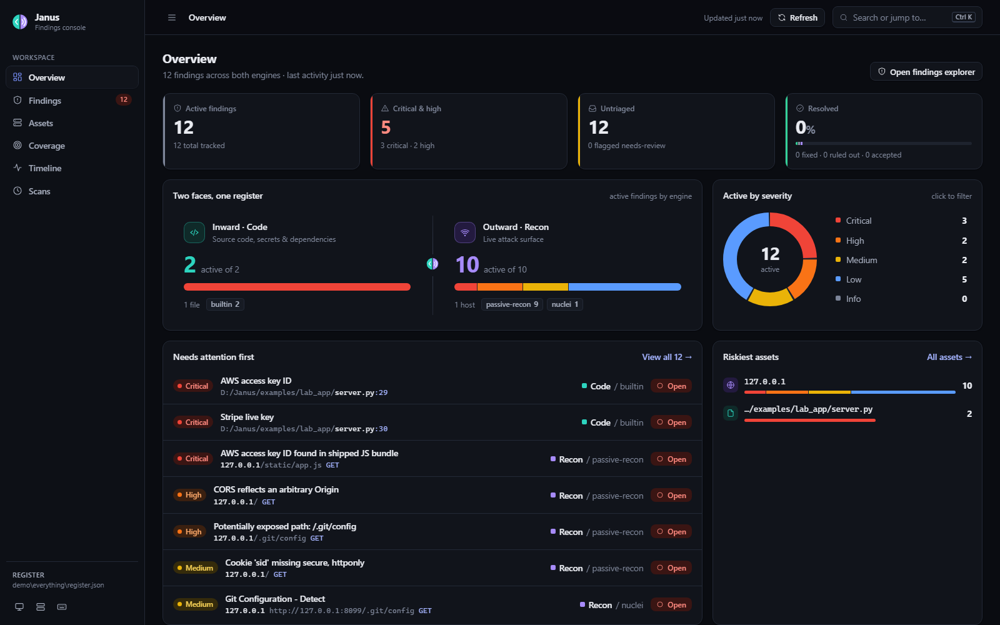
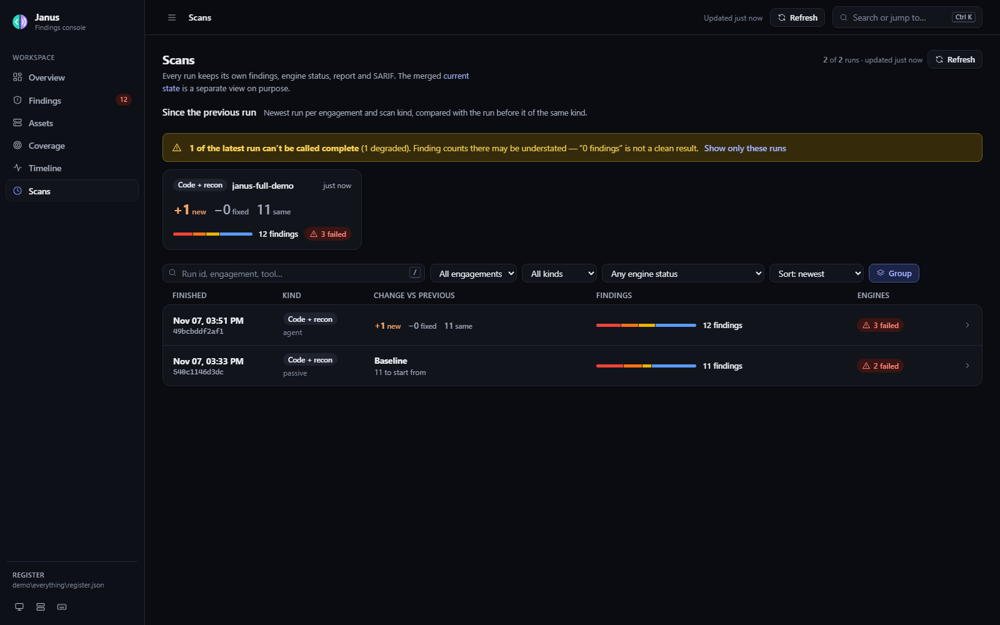
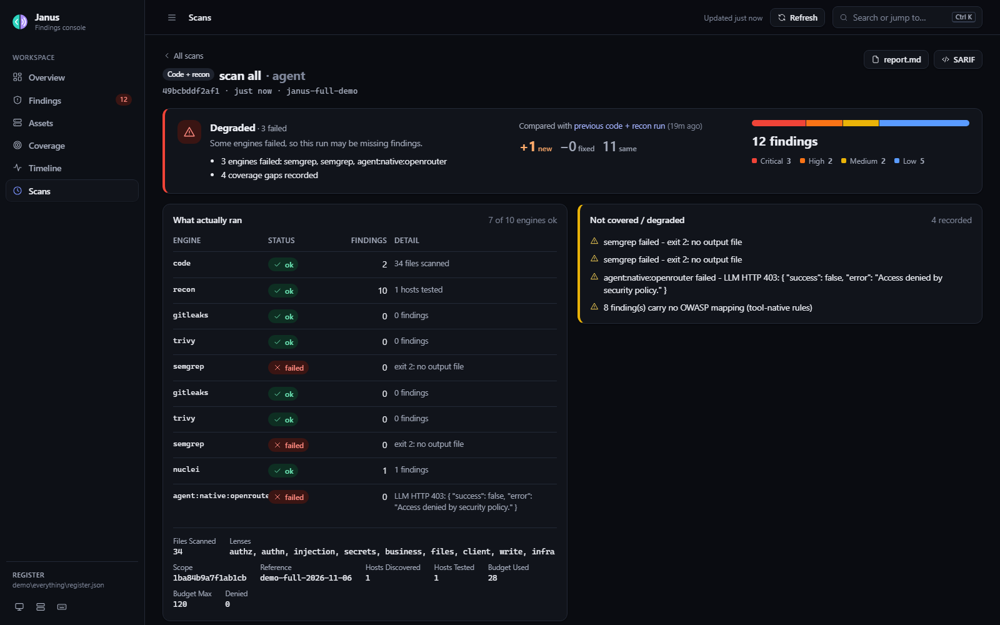
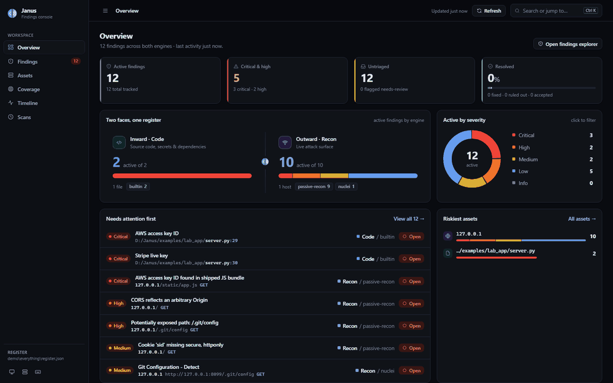
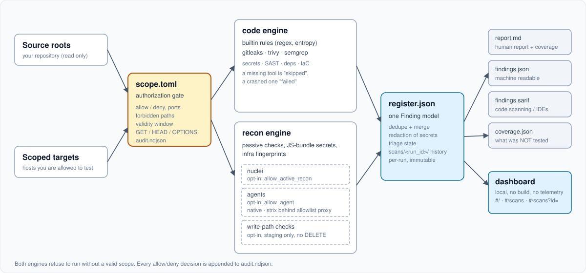

# Janus

**Two-engine security pipeline: source scanning and scoped external recon, one findings register, SARIF out.**

[](https://github.com/msmahdinejad/janus/actions/workflows/ci.yml)

[](LICENSE)



Janus reads your source (builtin rules plus gitleaks, trivy and semgrep when
installed), looks at a live deployment from the outside (passive checks,
JS-bundle secrets, infrastructure fingerprints, optional nuclei, optional AI
agents), normalizes everything into one finding model, and writes one register
with Markdown, JSON and SARIF reports. Next to the findings it writes
`coverage.json`: what was **not** tested. A local dashboard (no build step, no
telemetry, no cloud) shows current findings, triage state and per-run history.

> **Authorized targets only.** The `recon` engine sends traffic. Point it only
> at systems you own or have written permission to test. See
> [Authorization model](#authorization-model).

## Why this exists

- **Five prompts and a spreadsheet is not a pipeline.** Ad-hoc "review this for
  IDOR / secrets / authz" prompts leave no record of what was asked, what ran,
  or what was skipped. Janus versions those prompts as *lenses*, runs them in
  one command, and records which ones ran.
- **A findings list without coverage is not a report.** Zero findings from a
  scanner that crashed, was rate-limited by a WAF, or was never installed looks
  identical to a clean system. Every run records each tool as `ok`, `skipped`
  or `failed`, and `coverage.json` lists the gaps.
- **Scope should be a gate, not a sentence in a document.** Both engines refuse
  to run without a valid `scope.toml`, and the HTTP client enforces it on every
  request.

## Quickstart (about two minutes)

```bash
git clone https://github.com/msmahdinejad/janus.git
cd janus
python -m venv .venv
. .venv/bin/activate              # Windows: .venv\Scripts\activate
pip install -e .
janus demo                        # synthetic data, opens the dashboard on 127.0.0.1:8787
```

`janus demo` loads synthetic findings about a fictional company. To produce
real output instead, scan the bundled, deliberately vulnerable fixture. This
needs no external tools and sends no traffic:

```bash
janus scan code --scope examples/demo-fixture/scope.demo.toml --out out/demo --fail-on none
janus dashboard --register out/demo/register.json
```

Then look at what ran and what did not:

```bash
janus doctor                      # which optional scanners and LLM providers are available
```

Optional scanners (semgrep, gitleaks, trivy, nuclei, subfinder) make the code
engine deeper; none is required. `bash scripts/install-tools.sh` is a
best-effort installer. `docker/Dockerfile` is an all-tools image recipe; it pulls
unpinned `latest` base images, so pin the tags before relying on it.

**Platform notes.** Windows, Linux and macOS are supported by the Python code.
semgrep crashed on native Windows in our test setup; Janus reported it as
`failed` (not as a clean result). Pass `--no-semgrep`, or run it under WSL or
Docker. `trivy` downloads its vulnerability database on first use;
if that registry is blocked, `janus doctor` prints the
`TRIVY_DB_REPOSITORY` setting to use, and `--offline` skips CVE lookups.

## Feature tour

### Code engine

`janus scan code` reads your own repository. Zero-dependency builtin rules cover
SQL built from f-strings, `eval`/`exec`, `shell=True`, unsafe deserialization,
disabled TLS verification, unverified JWTs, CORS wildcards, hardcoded secrets
and keys, unpinned or root-running containers and CI script injection. If
installed, semgrep adds data-flow rules, gitleaks adds dedicated secret
detection, and trivy adds dependency CVEs, IaC misconfiguration and more
secret patterns. `--diff origin/main` scans only changed files, and
`--baseline FILE` suppresses accepted findings so CI stays green without
re-triaging.

### External engine

`janus scan recon` is passive by default and GET-only: Certificate
Transparency subdomain discovery, DNS (with a DNS-over-HTTPS fallback),
security headers, cookie flags, a non-destructive CORS-reflection probe, a
short sensitive-path check with SPA-fallback detection, secrets inside served
JavaScript bundles, infrastructure fingerprints, and SPF/DMARC presence.
`--mode active` adds nuclei templates and needs its own opt-in in the scope.

### Agents

`--mode agent` adds an LLM agent for the bug classes a fixed rule set cannot
find (IDOR, business-logic gaps). Two backends:

| Backend | Where it runs | What it can do | Boundary |
|---|---|---|---|
| `native` (default) | in-process | `http_get`, `report_finding`, `finish` | the same scope-checked HTTP client as the rest of the engine: no shell, no POST, no unlisted host |
| `strix` | external container | `nmap`, `sqlmap`, browser, more | refused unless an allowlist egress proxy (`janus proxy`) is configured |

`janus scan all --lens all` runs the built-in review lenses (authz, authn,
injection, secrets, business, files, client, write, infra) in one command; the
prompts live in `janus/lenses.py` and each run records which ones executed.
Agent findings arrive as `confidence: needs-review` on purpose: an agent's own
confidence is not ground truth.

If the provider call fails (bad key, blocked network, HTTP 403), the run records
`agent:<backend>:<provider>` as `failed` in the engine table and in
`coverage.json`, and the rest of the run still completes. The screenshots below
were captured from exactly such a run: the model endpoint refused the key, so
they show no agent findings and a *Degraded* verdict.

```bash
python examples/lab_app/server.py --port 8099          # local calibration target, one flaw per lens
janus scan all --scope engagements/lab-full/scope.toml --out demo/everything \
  --mode agent --lens all --agent-providers openrouter --fail-on none
```

### Coverage contract

Each run writes `coverage.json` and appends a Coverage section to `report.md`:
every tool that was skipped or failed, every lens that did not run, and what
the engines could not observe. A clean result means "nothing found by what
ran", and the file tells you what ran.

### Scan history



Every run writes an immutable record to `out/scans/<run_id>/` (`scan.json`,
`findings.json`, `coverage.json`, `report.md`, `findings.sarif`). The merged
register is the *current* state; history keeps what each run saw. The `#/scans`
view lists runs newest first with severity chips and a delta against the
previous run of the same kind (code, recon, all).



Open a run (`#/scans?id=<run_id>`) for its counts, engine status
(ok / skipped / failed), findings with expandable evidence, coverage gaps, and
links to that run's `report.md` and SARIF.



The dashboard binds to `127.0.0.1`, makes no external requests and needs no
build step. Triage is keyboard-driven (`j`/`k`, `1`-`5`), with bulk actions, a
command palette (`Ctrl/Cmd K`) and CSV export. A non-loopback bind requires
both `--allow-remote` and `--token`.

## Authorization model

`scope.toml` is the gate. It is a **technical boundary the operator writes**,
not proof of ownership: Janus cannot verify that you are entitled to test a
host, and the `authorized_by` and `reference` fields are descriptive audit
labels. You are responsible for the targets you enter.

What the gate enforces, in code, on every request:

- **Allow / deny.** Exact hosts or `*.domain` wildcards in `[targets].allow`;
  `[targets].deny` always wins.
- **Ports and paths.** `allow_ports`, and `forbidden_paths` regexes.
- **Validity window.** `valid_from` / `valid_until`; an expired or `enabled =
  false` scope exits with code `2`.
- **Methods.** `GET`, `HEAD`, `OPTIONS` only. This is a constant in
  `janus/core/scope.py`, not a config flag.
- **Private addresses.** Loopback and RFC 1918 targets need
  `allow_private_targets = true`. Cloud metadata addresses are refused even then.
- **Budgets.** `max_rps` and `max_requests`.
- **Separate opt-ins.** `allow_active_recon` (nuclei) and `allow_agent` (LLM
  agent) are independent; turning one on does not turn on the other.
- **Write-path testing** (`allow_state_changing`) is opt-in, requires
  `require_nonprod_marker = true` (the host must look like staging/test/dev/qa),
  and `POST`/`PUT`/`PATCH` only. `DELETE`, `TRACE` and `CONNECT` are refused by
  construction even if listed.
- **Audit.** Every allow and every refusal is appended to `out/audit.ndjson`
  with the scope file's hash.

If you are unsure about a target, use the code engine or passive recon only.
[SECURITY.md](SECURITY.md) has the full statement and how to report a bug in
Janus itself.

## Providers (`--mode agent`)

Keys are read from environment variables only; `janus doctor` shows which are
set and never prints a value.

| Provider | Environment variable | Default model | API |
|---|---|---|---|
| `deepseek` | `DEEPSEEK_API_KEY` | `deepseek-flash` | chat completions |
| `glm` | `GLM_API_KEY` | `glm-5.3` | chat completions |
| `openai` | `OPENAI_API_KEY` | `gpt-6-astra` | Responses |
| `openrouter` | `OPENROUTER_API_KEY` | `deepseek/deepseek-v4.1-flash-1017` | chat completions |

The default ensemble is `deepseek,glm,openai`; providers without a key are
skipped, not required. Choose providers with `--agent-providers a,b`. Add or
override a profile (any OpenAI-compatible endpoint: vLLM, Ollama, LiteLLM, a
corporate gateway) with `--providers-file`; see `providers.example.toml`. If a
gateway rejects `httpx`'s TLS handshake, set `transport = "urllib"` in the
profile or use `janus llm-shim`. `janus doctor --check-models` asks each
provider what its key can reach.

## CLI reference

| Command | What it does |
|---|---|
| `janus init` | scaffold `scope.toml` and `out/` (`--interactive` asks questions) |
| `janus scan code` | source engine: builtin rules + semgrep/gitleaks/trivy if present |
| `janus scan recon` | external engine (`--mode passive\|active\|agent`) |
| `janus scan all` | one run, one register, one report: code + recon (+ agent lenses) |
| `janus report` | rebuild `report.md`, `findings.json`, `findings.sarif` from a `register.json` |
| `janus dashboard` | local dashboard (`--register`, `--port`, `--allow-remote --token`) |
| `janus demo` | load synthetic findings and open the dashboard |
| `janus doctor` | which tools and providers are available |
| `janus proxy` | allowlist egress proxy (GET/HEAD/OPTIONS, scope-checked, audited) for external agents |
| `janus llm-shim` | localhost OpenAI-compatible shim for gateways `httpx` cannot reach |
| `janus triage` | hand [TRIAGE.md](TRIAGE.md)'s deep-review protocol to a coding-agent CLI |

Common flags on `scan`: `--scope`, `--out`, `--fail-on {critical,high,medium,low,info,none}`
(default `high`), `--no-semgrep`, `--no-trivy`, `--no-gitleaks`, `--offline`,
`--diff BASE_REF`, `--baseline FILE`. Exit codes: `0` nothing at or above
`--fail-on` in **this run**, `1` something is, `2` the scope file is invalid,
expired or disabled (treat as a setup bug).

### `scope.toml`

```toml
[engagement]
name          = "my-first-scan"
authorized_by = "you@example.com"       # descriptive label
reference     = "SEC-1234"              # local engagement label (required)
valid_from    = "2026-11-05"
valid_until   = "2026-12-05"

[targets]
allow = ["example.com", "*.example.com"]
deny  = []
allow_ports = [80, 443]
forbidden_paths = ["^/admin/(delete|purge|drop)"]

[limits]
allow_active_recon     = false          # nuclei: opt in explicitly
allow_agent            = false          # LLM agent: separate opt-in
allow_private_targets  = false          # needed for localhost / lab targets
require_nonprod_marker = false
max_rps      = 3
max_requests = 5000

[code]
roots   = ["../path/to/your/repo"]
exclude = ["**/migrations/**"]
```

`janus init --dir my-engagement --interactive` writes this for you.
Write-path testing (`allow_state_changing`, `[[write.targets]]`) is documented
in [USAGE.md](USAGE.md).

## Architecture



Engines never talk to each other; both emit the same `Finding` model into one
register (`janus/core/store.py`), which deduplicates, redacts secret-shaped
strings in every free-text field, and keeps triage state. Reports are rendered
from the register. Details and the tool comparison behind each choice are in
[ARCHITECTURE.md](ARCHITECTURE.md).

```
janus/core/        Finding model, scope gate, register, report writers, provider profiles
janus/engines/     code/ (builtin + adapters)   recon/ (passive, nuclei, agents, write checks)
janus/dashboard/   FastAPI app + static page (no build step)
examples/          demo-fixture (synthetic data), lab_app (calibration target)
docs/              AGENT-GUIDE.md, QUICKSTART.fa.md, CI.md, assets/
```

## FAQ

**Will it produce false positives?** Yes. Builtin rules are heuristics
("this shape looks dangerous"), semgrep rules are stronger, and agent findings
are marked `needs-review`. Triage in the dashboard (`ruled-out`,
`accepted-risk`, `fixed`, `needs-review`), baseline accepted findings with `--baseline`, and use the
[false positive template](.github/ISSUE_TEMPLATE/false_positive.yml) to report
a rule that is wrong. [TRIAGE.md](TRIAGE.md) is a protocol for tracing
critical/high rows from source to sink.

**What does it cost?** The code engine and passive recon cost nothing. Active
mode spends scanner time and target traffic. Agent mode spends model tokens;
`--agent-max-turns` and `--agent-max-budget` cap a run, and `max_requests` caps
traffic to the target.

**Can I run it in CI?** The code engine, yes: see [docs/CI.md](docs/CI.md) and
[docs/ci/github-actions.example.yml](docs/ci/github-actions.example.yml)
(SARIF upload, `--diff`, exit codes). Recon is deliberately not wired into CI
here: a pipeline is an easy place for the authorization step to be skipped.

**Does it work air-gapped?** The code engine does, with `--offline` and
locally installed scanners (`--tools-dir`). Passive recon needs the network by
nature, and agent mode needs a reachable model endpoint (a local vLLM or Ollama
profile works). Nothing in Janus phones home.

**Does it send my code or findings anywhere?** Only in agent mode, to the
provider you configured, and the agent sees scope-checked HTTP responses from
the target, not your repository.

**Is a clean report a safe system?** No. Read `coverage.json`. Static analysis
shows what the source says, not what a running system does; recon shows what
this machine could observe from here; a WAF silently dropping probes looks
like "0 findings".

For a coding agent that sets everything up and runs it, see
[AGENTS.md](AGENTS.md) and [docs/AGENT-GUIDE.md](docs/AGENT-GUIDE.md) — the
complete, provider-agnostic setup guide: prerequisites, tools, model wiring,
the three scan levels, write-path checks, dashboard and a verification matrix.
A short manual quickstart in Persian: [docs/QUICKSTART.fa.md](docs/QUICKSTART.fa.md).
Agent briefs for reviewing or publishing this repo: [prompts/](prompts/).

## Development

```bash
pip install -e ".[dev]"
pytest -q
```

CI runs the suite on Python 3.11, 3.12 and 3.13, and runs `janus scan code`
against `examples/demo-fixture` end to end.

## Contributing, security, license

- [CONTRIBUTING.md](CONTRIBUTING.md) · [CODE_OF_CONDUCT.md](CODE_OF_CONDUCT.md) · [CHANGELOG.md](CHANGELOG.md)
- Report vulnerabilities in Janus privately: [SECURITY.md](SECURITY.md)
- MIT, with a use notice on the recon engine: [LICENSE](LICENSE)
